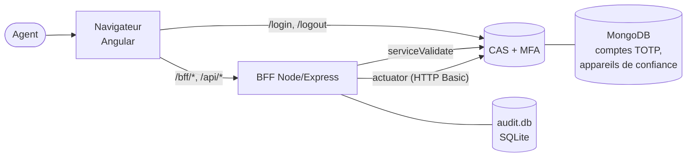
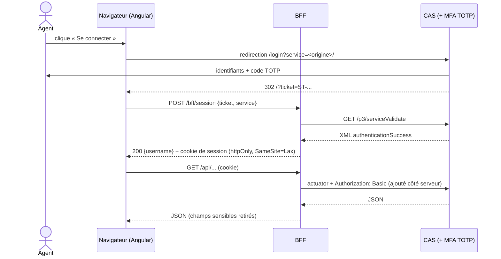

# 🏗️ Architecture technique

## 1️⃣ Vue d'ensemble

MIAM comporte deux modules livrées ensemble dans un seul conteneur :

| Brique | Technologie | Rôle |
| --- | --- | --- |
| **Application** | Angular 22, Angular Material 22 (M3), signaux, composants *standalone* | Interface de l'agent |
| **BFF** (*Backend For Frontend*) | Node.js ≥ 24 (min. 24.22.0 LTS), Express 5, `express-session`, `node:sqlite` | Sert l'application, valide les tickets CAS, relaie vers actuator, tient le journal d'activité |

> [!NOTE]
> Le navigateur ne communique **jamais** directement avec l'API Actuator du serveur CAS : il n'appelle que le module *BFF*, sur sa propre origine.



### Pourquoi un module BFF ?

Une première version appelait l'API Actuator directement depuis le navigateur, avec les identifiants HTTP Basic dans un fichier statique public : n'importe qui pouvait les lire et interroger le CAS sans jamais passer par le login ni le MFA. Le module BFF rend le MFA réellement bloquant et durcie mécaniquement la sécurité :

- les identifiants du service Actuator vivent uniquement dans la configuration du serveur ;
- les points d'accès `/api/*` ne sont accessible qu'avec une session ouverte après **validation réelle** d'un ticket CAS ;
- seul le module BFF connaît l'identité réelle de l'utilisateur (le service Actuator voit toujours le même compte technique) : c'est lui qui alimente le journal d'activité.

## 2️⃣ Flux de connexion



**Déconnexion** : le navigateur ferme d'abord la session du module BFF (`POST /bff/logout`) puis est redirigé vers `/logout?service=<origine>/deconnexion` : le TGT CAS est détruit, une reconnexion repasse par le login complet et le MFA.

## 3️⃣ Application Angular

### 🪧 Routes

| Chemin | Composant | Garde | Chargement |
| --- | --- | --- | --- |
| `/` | `Home` | — | initial |
| `/informations` | `informations` | — | initial |
| `/deconnexion` | `LoggedOut` | — | initial |
| `/users` | `UserList` | `casAuthGuard` | *lazy* |
| `/users/:username` | `UserDetails` | `casAuthGuard` | *lazy* |
| `/journal` | `Journal` | `casAuthGuard` | *lazy* |
| `**` | redirection vers `/` | — | — |

`casAuthGuard` renvoie vers l'accueil sans session, **sans** déclencher de connexion au serveur CAS automatique : seul le bouton « Se connecter » lance le parcours. Le guard ne lit que l'état d'affichage du navigateur ; la vraie barrière est la session du module BFF, revérifiée à chaque appel des `/api/*`.

### 🌐 Organisation du code (`src/app/`)

| Dossier | Contenu |
| --- | --- |
| `core/` | Services sans interface : `CasAuthService` (session), `GauthCredentialService`, `TrustedDeviceService`, `SsoSessionService`, `AuditLogService`, `AccountAdminService` (cascade de suppression), `ThemeService`, `ResponsiveService`, garde, modèles, configuration publique (`api-config.ts`) |
| `home/`, `logged-out/` | Pages publiques |
| `information/` | Pages publiques |
| `user-list/`, `user-details/`, `journal/` | Pages de gestion (chargées à la demande) |
| `brand-header/`, `theme-switch/`, `app-footer/`, `search-bar/` | Composants partagés |

> [!NOTE]
> Principes : composants *standalone*, état en **signaux** (`signal`, `computed`), aucun style inline (sauf ceux injecté par Material), aucun appel HTTP hors des services de `core/`, breakpoints via `ResponsiveService`.

### 🧰 Configuration publique

`/env.js` (route du module BFF, ou `public/env.js` en développement) permet de surcharger la configuration publique de l'application, notamment `window.__env` avant le démarrage d'Angular :

- `casBaseUrl` : URL de base du serveur CAS (http?s:`<host>`:?`<port>`/?cas),
- `prefixUrl` : permet d'injecter un prefix aux routes définies.
- `logoUrl` : pour ajouter un logo d'entreprise,
- `appAuthor` : pour ajouter le nom de l'entreprise,
- `privacyController` : DPO, Personne chargée de piloter la conformité RGPD de l'établissement,
- `privacyDpoContact` : Contact du DPO,
- `privacyLegalBasis` : mission d'intérêt public / intérêt légitime,
- `auditRetentionMonths` : Durée de rétention des données (6 à 12 mois) conformément au RGPD.
- `environnement` : défini le type d'environnement cible de MIAM.

Une même image sert tous les environnements, seules les variables d'environnement du conteneur changent. Rien de secret n'y figure.

## 4️⃣ Module BFF (`server/`)

| Fichier | Rôle |
| --- | --- |
| `index.js` | Point d'entrée : charge la configuration, démarre le serveur |
| `config.js` | Lecture des variables d'environnement, **refus de démarrer en production** si un secret manque |
| `app.js` | Application Express (routes, session, relais actuator, journal) — `createApp(config)` est testable sans réseau |
| `test/` | Tests `node:test` (voir [Tests unitaires](../developpement/test-unitaire.md)) |

### 🪧 Routes

| Route | Authentification | Rôle |
| --- | --- | --- |
| `GET /env.js` | non | Configuration publique |
| `GET /api/public/healthcheck/status` | non | Point de santé (journal SQLite + CAS), 200 / 503 / 429 — voir [Déploiement](../exploitation/deploiement.md) |
| `POST {prefixUrl}/bff/session` | non | Valide le ticket auprès du serveur CAS, lit les groupes (`memberOf`), déduit le profil et ouvre la session ; **403** si l'agent n'est dans aucun groupe |
| `GET /bff/session` | session | Identité et profil de l'agent (401 sinon) |
| `POST {prefixUrl}/bff/logout` | — | Détruit la session |
| `GET {prefixUrl}/bff/audit-log` | session **admin** | 2 000 dernières entrées du journal (403 pour la consultation) |
| `GET /api/*` | session | Relais de lecture vers l'API Actuator du serveur CAS |
| `DELETE /api/*` | session **admin** | Relais de suppression (403 pour la consultation, rien n'est envoyé à CAS) |
| `POST`/`PUT`/`PATCH /api/*` | session | **405** : seules la lecture et la suppression sont relayées (l'import de comptes TOTP, par exemple, n'est pas exposé) |
| autres | non | Fichiers statiques, puis `index.html` (routes Angular) |

### Session

Cookie `totp-admin-session`, `httpOnly`, `SameSite=Lax`, `Secure` si `COOKIE_SECURE=true`, durée 8 h (alignée sur la durée de vie du TGT CAS : la session du module BFF ne doit pas survivre au ticket qu'elle représente).

> [!CAUTION]
> Stockage des sessions **en mémoire** : suffisant pour une instance unique, mais un redémarrage du module BFF déconnecte les agents.

_
> [!NOTE]
> **CSRF** : `SameSite=Lax` suffit — toutes les requêtes d'état passent par `fetch`/XHR same-site depuis Angular, jamais par un `<form>` classique ; `Lax` empêche l'envoi du cookie sur une requête cross-site.

### 🛡️ Données sensibles retirées

L'API Actuator renvoie pour chaque compte TOTP le secret partagé et les codes de secours. Aucune page ne les affiche : le BFF retire `secretKey`, `validationCode` et `scratchCodes` de toute lecture `GET /api/gauthCredentialRepository[/…]` avant de répondre.

> [!CAUTION]
> Le navigateur (mémoire, cache, onglet Réseau) ne voit **jamais** ces champs. Toute nouvelle route qui relaierait des comptes TOTP doit conserver ce filtrage.

## 5️⃣ 🗄️ Journal d'activité

Une base de données SQLite propre au module BFF (`server/data/audit.db`) — **pas** une base MongoDB, qui appartient à CAS.
Une action n'est journalisée que si l'API Actuator répond par un succès (2xx) : une suppression refusée par le serveur CAS ne doit pas apparaître comme réussie.

| Colonne | Contenu |
| --- | --- |
| `timestamp` | Date ISO 8601 (UTC) |
| `actor` | Identifiant CAS de l'agent (celui de la session) |
| `action` | `DELETE_TOTP_ACCOUNT`, `REVOKE_TRUSTED_DEVICE` ou `REVOKE_SSO_SESSION` |
| `target` | Compte concerné (`NULL` pour une suppression en masse) |
| `detail` | `recordKey` de l'appareil, identifiant du TGT, ou « suppression en masse (tous les comptes) » |

Pour une session SSO, l'application ajoute `?principal=<compte>` à la requête (le TGT seul ne permet pas de retrouver le compte) ; le paramètre est ignoré par le serveur CAS.

## 6️⃣ Structure du dépôt

```text
miam/
├── src/                  # application Angular
│   ├── app/              #   composants, services (voir ci-dessus)
│   └── testing/          #   doublures partagées par les tests unitaires
├── server/               # BFF (config.js, app.js, index.js, test/)
├── e2e/                  # tests Playwright
├── public/               # ressources servies (images/, favicon/, env.js)
├── design/               # sources graphiques non livrées (logos, anciennes marques)
├── security/zap-reports/ # rapports de scan ZAP
├── docs/                 # cette documentation
├── Dockerfile, docker-compose.yml, .env.example
└── CHANGELOG.md, README.md
```

## 📌 Pied de page

> [!NOTE]
> Ce document fait partie de la documentation de MIAM.\
> Toute suggestion d'amélioration est bienvenue.

🛟 [Intégration avec le CAS](./integration-cas.md)

[Retour vers la page principale](../README.md)

> 🔚 -= Fin de la page =-
