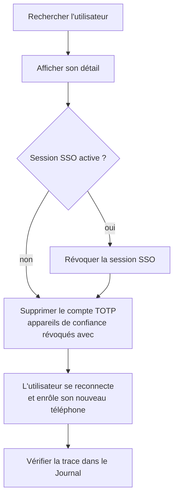

# 🧑‍💼 Parcours de l'agent

Cette page décrit l'usage de MIAM par un agent du centre de services : se connecter, retrouver un utilisateur, agir, vérifier la trace.

## 1️⃣ Se connecter

1. Ouvrir l'application : la page d'accueil (« **Bienvenue, ...** ») est la seule page publique (avec informations).
2. Cliquer sur **Se connecter** : redirection vers le serveur CAS.
3. S'authentifier sur le serveur CAS puis saisir le **code TOTP** — le code est exigé à chaque connexion, même sur un poste déjà reconnu.
4. Retour sur MIAM : la page de gestion s'ouvre. Un ticket refusé affiche un message d'erreur et laisse réessayer.

> [!NOTE]
> Un accès direct à une page de gestion sans être connecté renvoie à l'accueil. Aucune connexion n'est lancée automatiquement.

Selon ses groupes dans l'annuaire, l'agent obtient un profil :

| Profil | Ce qu'il voit et peut faire |
| --- | --- |
| **Administration** | Tout : listes, détail, suppression de comptes TOTP, révocation d'appareils et de sessions, **Journal** |
| **Consultation** (étiquette « Consultation » dans la barre d'outils) | Lecture seule : listes et détail, sans boutons Supprimer / Révoquer, sans compteur ni page Journal |

Un agent authentifié mais dans aucun groupe voit « **Accès refusé** » sur l'accueil et n'ouvre pas de session ; il doit demander son habilitation à l'administrateur de l'annuaire.

L'agent doit lui-même avoir un compte TOTP enrôlé : s'il n'en a pas, le serveur CAS lui propose l'enrôlement lors de sa première connexion.

## 2️⃣ La page de gestion (`/users`)

| Zone | Contenu |
| --- | --- |
| **Compteurs** | Comptes TOTP enrôlés · Appareils de confiance · Sessions SSO actives · Suppressions journalisées (passe en rouge à 1 000 000 d'entrées, signal d'anomalie : la purge automatique conserve 12 mois au plus) |
| **Recherche** | Filtre simultanément les trois listes sur l'identifiant (ou le nom d'appareil) |
| **Onglets** | *Comptes TOTP*, *Appareils de confiance*, *Sessions SSO* — chacun paginé (10 / 25 / 50 / 100 lignes) |
| **Pastille** | Verte si l'utilisateur a une session SSO active, grise sinon |
| **Actions** | **Afficher** (page de détail) · **Supprimer** (compte TOTP) · **Révoquer** (appareil, session) |

## 3️⃣ Le détail d'un utilisateur (`/users/:identifiant`)

Trois cartes — comptes TOTP, appareils de confiance, sessions SSO — avec, sur chaque ligne, le bouton d'action correspondant. Le bouton **Retour** ramène à la liste. L'identifiant porte la même pastille de session.

## 4️⃣ Les actions

Toute action destructrice ouvre une **boîte de confirmation** (bouton *Annuler* sélectionné par défaut, Échap pour annuler), puis affiche un message de résultat, également annoncé par les lecteurs d'écran et fermable par « Fermer le message ».

### Supprimer un compte TOTP

- Les API Actuator ne suppriment que **par utilisateur** : l'opération retire **tous** les comptes TOTP de la personne, la confirmation le rappelle.
- Les **appareils de confiance** de l'utilisateur sont **révoqués avant** le compte, afin qu'aucun appareil ne reste orphelin (un appareil de confiance sans compte TOTP laisserait contourner le code). Si une révocation échoue, le compte n'est pas supprimé.
- Au prochain passage sur le serveur CAS, l'utilisateur est invité à s'**enrôler de nouveau**.

### Révoquer un appareil de confiance

Retire la dispense de code d'un appareil précis ; l'utilisateur devra ressaisir un code TOTP à sa prochaine connexion depuis cet appareil.

### Révoquer une session SSO

Déconnecte réellement l'utilisateur de CAS et de toutes ses applications.

### Supprimer son propre compte

> [!CAUTION]
> Si l'agent supprime **son** compte TOTP, MIAM le **déconnecte immédiatement** : sa session ne pourrait plus être revalidée par le MFA.

## 5️⃣ Cas d'usage

### « J'ai perdu / changé mon téléphone »

> [!TIP]
> Révoquer d'abord la session SSO évite qu'une session déjà ouverte conserve son authentification : l'utilisateur est alors forcément renvoyé vers CAS.

### « Je suis bloqué malgré un compte supprimé »

La décision « MFA vérifié » reste attachée à la session SSO : **révoquer la session** de l'utilisateur (onglet *Sessions SSO*) puis lui demander de se reconnecter.

### Retirer un poste partagé de la confiance

Onglet *Appareils de confiance* → rechercher l'utilisateur → **Révoquer** la ligne du poste.

## 6️⃣ Le journal d'activité (`/journal`)

Accessible par le bouton **Journal** de la barre d'outils. Tableau *Date · Agent · Action · Compte concerné*, trié du plus récent au plus ancien (2 000 entrées maximum), avec **deux filtres indépendants** :

| Filtre | Répond à la question |
| --- | --- |
| *Filtrer par agent (qui a agi)* | « Qu'a fait tel agent ? » |
| *Filtrer par compte concerné (qui a subi l'action)* | « Que s'est-il passé sur le compte de tel utilisateur ? » |

Cliquer sur un compte concerné ouvre sa page de détail. Une suppression en masse (sans compte cible) est tracée avec la mention « suppression en masse ».

## 7️⃣ Confort d'usage

- **Informations personnelles** : le lien « Informations » (icône ℹ️ sur mobile) de l'en-tête et de la barre d'outils ouvre la page d'information sur le traitement des données (responsable, finalité, durée de conservation, droits) ;
- **Thème** : pastilles bleu/orange dans la barre d'outils (orange par défaut) ; le choix est mémorisé dans le navigateur.
- **Mobile** : barre d'outils condensée (icône, navigation sans libellés), pied de page sur une ligne.
- **Déconnexion** : bouton à droite de la barre d'outils ; l'écran « Déconnexion réussie » confirme que la session CAS est détruite.

## 📌 Pied de page

> [!NOTE]
> Ce document fait partie de la documentation de MIAM.\
> Toute suggestion d'amélioration est bienvenue.

[Retour vers la page principale](../README.md)

> 🔚 -= Fin de la page =-
